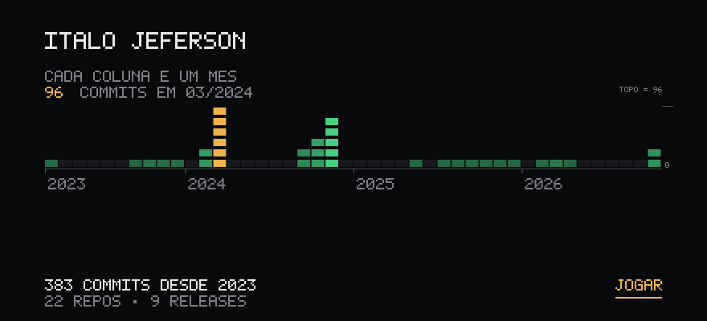
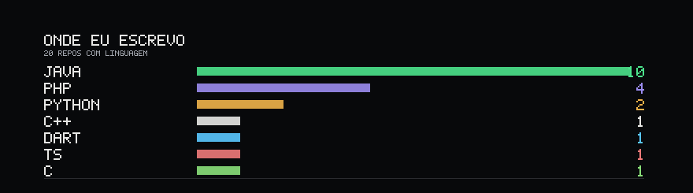
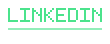
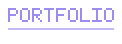
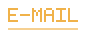

  <a href="https://italosixx.github.io/ItaloSixx/">
    <picture>
      <source media="(max-width: 700px)" srcset="assets/scene-mobile.svg">
      
    </picture>
  </a>

  <picture>
    <source media="(max-width: 700px)" srcset="assets/stack-mobile.svg">
    
  </picture>

  &nbsp;&nbsp;&nbsp;&nbsp;&nbsp;&nbsp;&nbsp;&nbsp;

