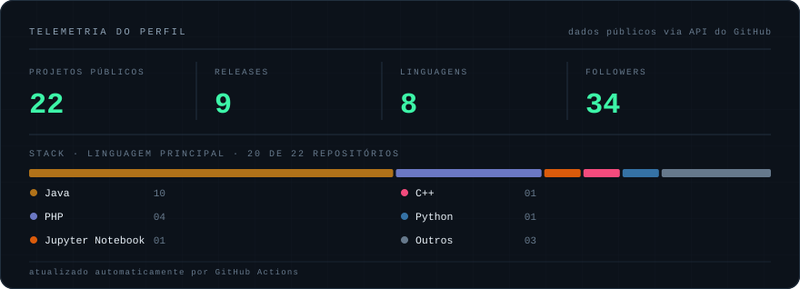

<div align="center">
  <picture>
    <source media="(prefers-color-scheme: dark)" srcset="assets/hero-dark.svg">
    <source media="(prefers-color-scheme: light)" srcset="assets/hero-light.svg">
    
  </picture>
</div>

Construo software onde errar não é uma opção de design: **regulação médica de urgência**, telemetria de campo e firmware que precisa acordar todos os dias. Trabalho do firmware ao dashboard — ESP32, API, app e banco — em sistemas usados por gente que não pode esperar por um deploy.

Atuo no **SAMU 192 / regional de Guanambi (BA)** e no ecossistema **SIRUS** (Sistema Integrado de Regulação e Urgência em Saúde), desenvolvido no **IF Baiano – Campus Guanambi**, onde me formei em Análise e Desenvolvimento de Sistemas.

## `01` — em produção

**[Hidromaq](https://github.com/ItaloSixx/Hidromaq)** · sistema de gestão comercial para irrigação e energia solar. Substituiu planilha por aplicativo: estoque, vendas, clientes e simulação de bombeamento — Flutter, build Android e Windows, ciclo de release versionado.

<div align="left">
  <a href="https://github.com/ItaloSixx/Hidromaq/releases/latest">
    
  </a>
  <a href="https://github.com/ItaloSixx/Hidromaq/commits/main">
    
  </a>
</div>

## `02` — trabalho selecionado

| Projeto | O que resolve | Stack |
|---|---|---|
| **[firmwareV2](https://github.com/ItaloSixx/firmwareV2)** | Firmware do equipamento de campo do meu TCC: medição dendrométrica com display touch, LVGL e tarefas FreeRTOS em ESP32-S3 | `C` `ESP-IDF` `FreeRTOS` `LVGL` |
| **[MonitorUmidade](https://github.com/ItaloSixx/MonitorUmidade)** | Dashboard de umidade do solo lendo 3 sensores via serial, com gráfico em tempo real | `Python` `Flet` `Plotly` `Arduino` |
| **[laravel-api](https://github.com/ItaloSixx/laravel-api)** | API Laravel 11 com camada de serviços, Docker/Nginx e testes em SQLite in-memory | `PHP` `Laravel` `MySQL` `Docker` |
| **[rastreamento_flutter](https://github.com/ItaloSixx/rastreamento_flutter)** | Rastreamento de frota em tempo real, mesma especificação em duas stack para comparar custo de manutenção | `Flutter` `Dart` |
| **[rastreamento_reactnative](https://github.com/ItaloSixx/rastreamento_reactnative)** | Par React Native do projeto acima, containerizado | `TypeScript` `React Native` `Docker` |
| **[FocoFacil](https://github.com/ItaloSixx/FocoFacil)** | Gestor de tarefas com método Pomodoro, notificações e persistência local | `Java` `Android` `SQLite` |
| **[Anota](https://github.com/ItaloSixx/Anota)** | App de anotações usado como campo de treino para dominar o core do Laravel | `PHP` `Laravel` `Blade` |
| **[MathX](https://github.com/ItaloSixx/MathX)** | Gerador de listas de exercícios matemáticos com intervalo e operações configuráveis | `PHP` `Laravel` `Bootstrap` |

<details>
<summary><b>&nbsp;ver mais 14 repositórios públicos</b></summary>
<br>

Estudos de Android (layouts, widgets em runtime, persistência, calculadora), RoboCup SSL (`base-projectSSL`), desafios de algoritmo (`TargetChallengeSP/RP`) e experimentos de Flutter. Histórico de aprendizado, mantido público de propósito.

</details>

## `03` — telemetria

<div align="center">
  <picture>
    <source media="(prefers-color-scheme: dark)" srcset="assets/telemetry-dark.svg">
    <source media="(prefers-color-scheme: light)" srcset="assets/telemetry-light.svg">
    
  </picture>
</div>

## `04` — stack por camada

```
firmware      C · ESP-IDF · FreeRTOS · LVGL · PlatformIO
backend       PHP 8 · Laravel 11 · APIs REST · MySQL · Docker
mobile        Flutter · Dart · React Native · Java/Kotlin (Android)
dados         Python · Plotly · Flet · pyserial
infra         Linux · Nginx · Docker Compose · Git · GitHub Actions
```

## `05` — como eu trabalho

- **Passivo antes de agressivo.** Em sistema de saúde, primeiro observo, documento e meço; só depois mexo.
- **Fronteira explícita.** Firmware não sabe o que a API faz, a API não sabe o que o app desenha. Contrato entre camadas, não acoplamento.
- **Release é o artefato.** Se não tem versão, changelog e download funcionando, não está pronto.
- **Legibilidade ganha de esperteza.** O próximo a ler esse código pode ser eu às 3h da manhã durante um plantão.

## `06` — contato

<div align="left">
  <a href="https://www.linkedin.com/in/italo-jeferson-32778726b/"></a>
  <a href="mailto:italojefer55@gmail.com"></a>
  <a href="https://www.instagram.com/italo6s"></a>
</div>

<sub>Banner e cards gerados por <a href="scripts/profile_assets.py"><code>scripts/profile_assets.py</code></a> a partir da API do GitHub — sem serviços de terceiros, atualizados por Actions.</sub>
